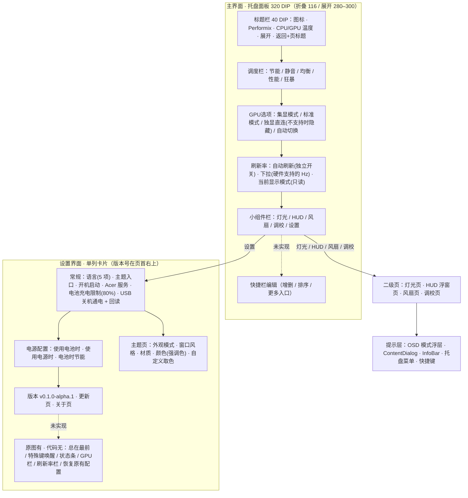

# Performix UI 架构（评审 · 重排 · 补全）

- **输入**：用户手绘 `Preformix.drawio`（115 个 mxCell：58 顶点 / 55 边，两层：软件界面 / 设置界面）
- **产出**：`docs/design/UI-ARCH.drawio`（130 顶点 / 4 条正交边，共 136 个 mxCell）、本文件
- **评审基线**：`src/Performix.App/Pages/*.xaml`（7 页）、`Shell/ShellWindow.xaml(.cs)`、`Services/*.cs`、`src/Performix.Core/**`
- **版本**：`0.1.0-alpha.1`（`Directory.Build.props`）

一句话结论：**这张图可以当「导航/信息架构基线」，还不能当「UI 设计基线」** —— 两级骨架对，内容层、命名、数据来源三样缺一不可（详见 §4、§6）。

---

## 1. 结构图（Mermaid，GitHub 原生渲染）

> 图里未画、但代码里存在的一层：`App(WinUI) → Core(Hardware/Mode/Gpu/Rgb/Configuration/Services) → OS(ACPI-WMI / PSSvc 管道 / NVAPI / HID / Windows 电源方案 / 计划任务)`，见 §5。

---

## 2. 组件清单

状态取值：**已实现** / **占位**（控件在、本机不可用或缺依赖）/ **未实现**。

### 2.1 主界面（托盘面板，固定宽 320 DIP）

| 组件 | 作用 | 数据来源 | 当前实现状态 |
|---|---|---|---|
| 图标 | 标题栏左端品牌标记（占位图，非 OEM 标志） | `Assets/performix-mark.png` | 已实现 |
| Performix | 产品字标 | 静态文本 | 已实现 |
| 状态信息 | 标题栏常驻 CPU/GPU 两颗温度，各带标签 | `TelemetryCoordinator` → `IHardwareService`（PSSvc 管道 cmd15 → ACPI 热区 / NVAPI / NVML） | 已实现 |
| 展开按钮 | 40×40 命中区，折叠 116 ↔ 展开 300 DIP | `ShellWindow`（AppWindow 逐帧 MoveAndResize） | 已实现 |
| 返回 + 页面标题 | 二级页的返回键 + 页名 | `ShellWindow.PageChrome` / `PageTitleKeys` | 已实现 |
| 调度栏 | 5 个模式按钮：节能/静音/均衡/性能/狂暴 | `IHardwareService.SetPowerMode` → Acer WMI + PSSvc cmd32；`WindowsPowerPolicy` 追加 Windows 覆盖 | 已实现 |
| GPU选项 | 4 块 tile：集显/标准/独显直连/自动切换 | `NvidiaDdsService`（NVAPI DDS）+ WMI `SetGpuMuxMode`；`IsBiosDiscreteGpuActive` | 占位 · 本机无 MUX：独显直连不可用，四块仍显示且无选中 |
| 自动刷新（chip） | 电池 60 Hz / 插电最高刷新率 | `cfg.Display.AutoRefreshRate` + 电源切换事件 | 已实现 |
| 刷新率下拉 | 列出显示器支持的 Hz 并切换 | `DisplayManager.GetSupportedRefreshRates()` / `SetRefreshRate()` | 已实现 |
| 当前显示模式（只读） | 行尾状态文本 | `ActiveGpuDisplayMode` | 已实现 |
| 小组件栏 | 5 个入口：灯光 / HUD / 风扇 / 调校 / 设置 | `ShellWindow.NavigateTo`（单窗口 Frame 切页） | 已实现 |
| 快捷栏编辑 | 小组件栏增删 / 排序 / 加更多入口 | 无配置项、无编辑 UI | 未实现 |

### 2.2 二级页 · 灯光页

| 组件 | 作用 | 数据来源 | 当前实现状态 |
|---|---|---|---|
| 设备列表（HID/刷新） | 枚举灯效设备（键盘 / 灯条 / Logo / OEM USB），选中即换编辑区 | `OemLightingController`、`AcerHidLightingDevice`、`AcerEcLightingDevice`、`EneRgbClient` | 已实现 |
| 亮度 | 键盘/灯条亮度 | `LightingConfig.Keyboard.Brightness` | 已实现 |
| 灯效模式（静态/动态/软件） | 硬件模式 + 软件效果引擎 | `AcerEcLightingDevice` / `CustomLightingEffectsEngine` | 已实现 |
| 预设主题 | 一键成套配色 | `LightingConfig.Keyboard.PresetTheme` | 已实现 |
| 分区 Z1–Z4 | 四区独立配色 / 全同步 | `SelectedZone`、`SyncZones` | 已实现 |
| 单键直接编辑（Direct） | 逐键改色（用户列的「缺项」，其实已实现） | `KeyboardLayoutView` + `OemUsbKeyboardLayouts.json` | 已实现 |
| 背光超时 | 无操作熄灯秒数 | `BacklightTimeoutSeconds` | 已实现 |

### 2.3 二级页 · HUD 浮窗页

| 组件 | 作用 | 数据来源 | 当前实现状态 |
|---|---|---|---|
| 指标槽位（增删） | 每个槽选一个指标 + 图形开关 + 删除 | `OverlayConfig` + `Performix.Overlay` | 已实现 |
| CPU/GPU 指标 | 槽位的指标选择 | `TelemetryCoordinator` 指标集 | 已实现 |
| 曲线开关 | 槽位内是否画历史曲线 | `OverlayConfig` | 已实现 |
| HUD 缩放 50–200% | 整体缩放 | `ScalePercent` | 已实现 |
| 背景不透明度 | 背景 alpha | `BackgroundAlphaPercent` | 已实现 |
| 文字不透明度 | 文字 alpha | `TextAlphaPercent` | 已实现 |
| 位置（横/纵） | 左中右 / 上中下 | `OverlayConfig` | 已实现 |
| 显示 FPS | ETW 帧率采样 | `EtwFpsMonitor` | 已实现 |
| 刷新间隔 1 s（只读） | 遥测主定时器固定 1 s | `TelemetryCoordinator`（`MasterTimer = 1000`） | 已实现 |

### 2.4 二级页 · 风扇页

| 组件 | 作用 | 数据来源 | 当前实现状态 |
|---|---|---|---|
| 5 个模式配置 | 每个性能模式一套风扇策略 | `FanConfig.Quiet/Eco/Balanced/Performance/Turbo`（`ModeFanCurveConfig`） | 已实现 |
| 4 种控制 | Auto / Max / Custom / Curve | `ControlMode` + `WmiController.Fans` | 已实现 |
| 8 点曲线编辑（CPU/GPU） | 温度→占空比，8 点、≥6 ℃ 间距、5% 步进 | `FanCurveCanvas` + `GHelperFanCurve` / `FanCurveProfile` | 已实现 |
| Ramp / 回差 / 应用 | 升降温速率、回差、Apply / Restore | `CurveRampUp/DownPercentPerSecond`、`CurveHysteresisCelsius` | 已实现 |

### 2.5 二级页 · 调校页

| 组件 | 作用 | 数据来源 | 当前实现状态 |
|---|---|---|---|
| 复用 5 模式选择 | 与主界面同一套 `ModeTileButtonStyle` | `SetModeCommand` | 已实现 |
| CPU 调度 | 电源来源 / 最大处理器状态 / Boost Mode / EPP / 核心停放 min-max | `CpuScheduling`（Windows 电源方案 SUB_PROCESSOR，免驱） | 已实现 |
| GPU 超频（核心/显存偏移） | 0–500 MHz / 0–1000 MHz 偏移 + Apply/Reset | `NvidiaGpuControl.ClockTuning`（NVAPI） | 已实现（不可用时保留卡片并显示原因） |
| 高级（需驱动，缺则灰显） | 启用调校 / PL1 / PL2 / Tau / CPU 欠压 / PROCHOT / GPU 功率 / 动态加速 / 平台偏移 | `PreySenseDriverBackend`、`CpuPowerLimitController`、`CpuProchotController` | 已实现（缺驱动整段灰显 + InfoBar 说明） |

### 2.6 二级页 · 主题页

| 组件 | 作用 | 数据来源 | 当前实现状态 |
|---|---|---|---|
| 外观模式（深/浅/跟随） | 主题切换，立即生效 | `AppearanceService` / `ThemeManager` | 已实现 |
| 窗口风格（Win11/Win10） | DWM 圆角 + 控件圆角令牌 | `CornerRadiusHelper` | 已实现 |
| 材质（Mica/亚克力/纯色） | 窗口背景材质，不支持时**灰显不隐藏** | `MicaBackdrop` / `AppearanceService` | 已实现 |
| 颜色（强调色） | 跟随系统 / 固定 #3B82F6 / 自定义 | `AccentBrush` 等共享画刷 | 已实现 |
| 自定义取色（色环+8 预设+HEX） | 色环 160 DIP + 8 预设 + #RRGGBB 输入 | `ColorSpectrum` 基元 | 已实现 |

### 2.7 提示层

| 组件 | 作用 | 数据来源 | 当前实现状态 |
|---|---|---|---|
| 底部模式切换浮层（OSD） | 模式确认后从屏幕底部滑入的小卡片，失焦也不消失 | `ModeOsdWindow`（独立小窗，热复用） | 已实现 |
| ContentDialog 确认框 | 危险 / 长任务确认 | `ContentDialogUserPromptService` | 已实现 |
| InfoBar 提示条 | 页面顶部 toast，3 s 自动收起 | `ShellWindow.ShowToast` + `ShellInfoBar` | 已实现 |
| 托盘菜单（打开/退出） | 左键切换显示，右键两项 | `TrayIconService` | 已实现 |
| 快捷键（图案键·模式键） | 图案键召唤面板；模式键走 ACPI-WMI 事件 | `KeyboardHookService`、`AcerHotkeyWatcher`、`TurboKeyWatcher` | 已实现（固定，不可配置） |

### 2.8 设置界面

| 组件 | 作用 | 数据来源 | 当前实现状态 |
|---|---|---|---|
| 语言（5 项下拉） | 立即生效并写 `preysense.json` | `LocalizationService` + `UiText` + `ConfigurationService` | 已实现 |
| 主题（跳转二级页） | 纯导航行 | `SettingsPage.OpenTheme_Click` | 已实现 |
| 开机启动（计划任务） | 注册提权计划任务；不可用时开关禁用 | `StartupTaskService` | 已实现 |
| Acer 服务（停用 OEM） | 停用 Acer 后台服务省内存 | `AcerServiceDebloater` | 已实现 |
| 电池充电限制（80%） | 开关 +「限制 80%」提示行 | `BatteryControl` → `WmiController.SetBatteryMode` | 已实现 |
| USB 关机通电（关/10/20/30%） | 四档下拉 + 写入后回读 | `IHardwareService.Set/GetUsbChargingLevel` | 已实现 |
| 回读状态行（失败提示） | 回读失败/不适用时才显示 | `UsbChargingStatus` | 已实现 |
| 使用电池时（5 配置） | 拔电自动套用 | `ProfileManager.BatteryPowerMode`（默认 节能） | 已实现 |
| 使用电源时（5 配置） | 插电自动套用 | `ProfileManager.AcPowerMode`（默认 均衡） | 已实现 |
| 电池时节能（Windows） | 拔电打开系统节能 | `Battery.BatteryEnergySaver` | 已实现 |
| 版本号 `v0.1.0-alpha.1` | 页首右上，全应用唯一显示位置 | `UpdateCheckService.DisplayVersion` | 已实现 |
| 更新页（检查/下载进度/失败重试） | 检查 GitHub Release | `UpdateCheckService`（`UpdateFeedConfigured = false`，当前离线跳过） | 未实现 |
| 关于页（版本/许可） | 版本、第三方许可 | 无 | 未实现 |

---

## 3. 与原图的差异

### 3.1 新增（补全）

1. 风扇页单列成页（原图把风扇并进「调校」）——代码里是独立页，4 组控件。
2. 调校页拆出三块：CPU 调度、GPU 超频、高级（需驱动）。
3. 提示层：OSD 底部浮层、ContentDialog、InfoBar、托盘菜单、快捷键（原图没有）。
4. HUD 浮窗页 9 项（槽位/指标/曲线/缩放/两层不透明度/位置/FPS/固定 1 s）。
5. 灯光页补设备列表、分区 Z1–Z4、单键 Direct 编辑、背光超时。
6. 主题页补强调色、自定义取色、材质灰显规则。
7. 设置补 Acer 服务、电池充电限制、USB 四档 + 回读行、电池时节能、版本号。
8. 「快捷栏编辑」（虚线，未实现）。
9. 「更新页」「关于页」（虚线，未实现）。
10. 软件分层带（App → Core → OS）。
11. 图内 6 条注记，把「图与代码不一致」写在图上而不是只写在文档里。

### 3.2 删除 / 合并

1. 「软件界面」「设置界面」两个标题节点改成左右两条泳道。
2. 去掉「界面」中间层，主题页直接挂 5 个控件。
3. 去掉「个性化」分区：主题是独立页、电源配置是设置页的独立卡片。
4. 「调校(原风扇+调校)」拆成「风扇」「调校」两个入口。
5. 「选择框:包括自动模式和搜索到的可选项」拆成「自动刷新（独立开关）」+「刷新率下拉（硬件支持的 Hz）」。
6. 语言 4 项改为代码实测的 5 项（English / 简体中文 / हिन्दी / Español / Français）。
7. 删掉「进度条」：电池充电限制是开关 +「限制 80%」提示；USB 关机通电是四档下拉。
8. 「服务 / 调校 / 更新 / 关于」按代码归位：服务进常规卡片、调校成二级页、更新/关于虚线。
9. 「状态信息 / 展开按钮」收进标题栏容器，并补「返回 + 页面标题」。
10. 「总在最前 / 特殊键唤醒 / 状态条 / GPU栏 / 刷新率栏 / 恢复原有配置」保留但灰底虚线，集中进「原图有 · 代码无」。

### 3.3 布局与视觉

1. 两栏：左 40–1160（主界面 + 二级页 + 提示层 + 注记），右 1200–2320（设置），图例在右上 (2400, 80)。
2. 同类叶节点统一 160×40；横向 40 px 栅格（列步长 200）、纵向 24 px 栅格（行步长 64）。
3. 父级全部用带标题的 `swimlane`；层级只靠容器表达，不画 55 条树形边（原来那些边把「标题栏→图标」画成了并列关系）。
4. 只保留 4 条正交连线：小组件栏→二级页、设置→设置界面、App→Core、Core→OS，无交叉。
5. 按层上色：主界面蓝、二级页橙、提示层紫、设置绿、注记琥珀、分层中性灰；叶节点全白。
6. 字体统一 `Microsoft YaHei` 12pt（容器 14pt、注记 11pt）；显式浅底 + 深字，深色主题下不翻转、仍可读。
7. 图例三行：实线 = 已实现 / 虚线 = 未实现（节点或连线）/ 灰底 = 不可用或隐藏。

---

## 4. 评审意见（对着真实代码）

### 4.1 图里有、代码里没有

1. **总在最前** —— 全仓库没有这个设置。WinUI shell 是托盘面板：失焦自动隐藏（`Window_Activated` + `QueueAutoHide`），`Topmost` 只出现在 Legacy WPF 自己的窗口和 OSD 上。这个开关在现交互模型下没有意义。
2. **特殊键唤醒** —— 没有设置项。图案键召唤和模式键是固定实现（`KeyboardHookService` / `AcerHotkeyWatcher` / `TurboKeyWatcher`），用户不能开关、不能改键。
3. **状态条 / GPU栏 / 刷新率栏 三个可开关栏** —— 代码里没有这三件。HUD 是「指标槽位 + 曲线 + FPS」的模型（`OverlayConfig`），不是三条固定栏；而且它们被画在「主题 → 界面」下，归属也不对。
4. **更新页 / 关于页** —— 7 个页面里没有这两个。`UpdateCheckService` 存在但 `UpdateFeedConfigured = false`（设计上离线跳过），版本号只在设置页首右上以文本显示。
5. **「恢复原有配置（默认）」和「语言 4 项（正體中文/日本語）」** —— `ProfileManager.SourceProfileNames` 只有 Eco/Quiet/Balanced/Performance/Turbo；语言实测 5 项 en-US / zh-CN / hi-IN / es-ES / fr-FR，没有 zh-TW 和 ja-JP。另外「开放以便后续 PR 添加新语言」在代码里是 `UiText` 字典的开发现实，不需要画成 UI 节点。

### 4.2 代码里有、图里漏了

1. **风扇页整页**：5 个模式配置、Auto/Max/Custom/Curve 四种控制、8 点曲线编辑、Ramp/回差/Apply/Restore。
2. **调校页三块**：CPU 调度（电源/最大处理器状态/Boost/EPP/核心停放）、GPU 超频（核心/显存偏移）、高级折叠（驱动 InfoBar、PL1/PL2/Tau、欠压、PROCHOT、GPU 功率/动态加速/平台偏移）。
3. **HUD 浮窗页全部 9 项**（指标槽位、缩放、背景/文字不透明度、位置、FPS、固定 1 s 刷新）。
4. **提示层**：OSD 底部浮层、ContentDialog 确认、InfoBar、托盘菜单、快捷键。
5. **设置与主题里已实现但没画**：Acer 服务、电池充电限制、USB 四档 + 回读行、电池时节能、版本号；主题页的强调色、自定义取色、材质灰显规则。

### 4.3 层级不对

1. **「调校」被画成小组件入口**，且写成「原风扇+调校」合并 —— 代码里 `TuningPage` 和 `FansPage` 是两个独立二级页，各有入口按钮（小组件栏实际 5 个入口，不是 4 个）。
2. **状态条/GPU栏/刷新率栏挂在「主题 → 界面」** —— 与外观无关，属 HUD 内容配置；而且代码里没有这个三元组。
3. **「电源配置」挂在「个性化」下** —— 代码里它是设置页独立的 `Power Profiles` 卡片，与「常规」平级；「个性化」这个分区不存在（主题已提升为独立页，从常规进入）。
4. **「服务 / 调校 / 更新 / 关于」被画成设置页的平级大区** —— 服务是「常规」里的一行，调校是主界面入口的二级页，更新/关于没有页面。
5. **「状态信息 / 展开按钮」与「标题栏」平级**（还有一条边从「标题栏」指向「图标」，而「图标」不属于标题栏）—— 代码里三者都是标题栏的子元素。

### 4.4 逐项核对

| 原图项 | 代码事实 | 判定 |
|---|---|---|
| 五模式 节能/静音/均衡/性能/狂暴 | 顺序完全一致（Eco 0x06 / Quiet 0x00 / Balanced 0x01 / Performance 0x04 / Turbo 0x05）；电池默认节能、插电默认均衡 | ✅ 准确 |
| GPU 四选项 | 四块 tile 在，但标签是 Auto / Hybrid / Advanced Optimus / dGPU Only；隐藏条件是「BIOS 独显模式」 | ⚠️ 命名不符、隐藏条件不符 |
| 独显直连「不支持时隐藏」 | 本机无 MUX：四块仍显示、无任何一块选中、模式名显示「—」（`GpuMuxModeName = "N/A"` → 转换器映射成破折号） | ❌ 与实际相反 |
| 刷新率「自动模式在选择框里」 | 「自动」是独立 chip（电池 60 Hz / 插电最高），下拉只列硬件支持的 Hz（`"{hz} Hz"`） | ❌ 交互不符 |
| 状态条 / GPU栏 / 刷新率栏 可开关 | 无 | ❌ 代码没有 |
| 小组件栏 灯光/HUD/调校/设置 | 5 个固定入口：灯光 / HUD / 风扇 / 调校 / 设置，无增删排序 | ⚠️ 少「风扇」、无编辑能力 |
| 语言 4 项 | 5 项：English / 简体中文 / हिन्दी / Español / Français | ❌ |
| 开机启动 | 提权计划任务，`CanChangeRunOnStartup` 可禁用开关 | ✅ 准确 |
| 总在最前 | 无设置项；shell 失焦即隐藏 | ❌ |
| 特殊键唤醒 | 无设置项；图案键/模式键固定可用 | ❌（能力有、开关无） |

### 4.5 建议（按优先级）

1. **先定 GPU 四个名字**：要么沿用 OEM（集显/标准/独显直连/自动切换），要么沿用代码（Auto/Hybrid/Advanced Optimus/dGPU Only），二选一写进规范；现在图与代码两套词。
2. **改隐藏条件**：要么「DDS 不支持 → 隐藏 Hybrid/Advanced」，要么「无 MUX → 灰显并说明」，不要用「BIOS 独显模式」当唯一判据 —— 否则无 MUX 的机器上四块都能点、点了没反应。
3. **补交互**：把「自动刷新」从下拉里拆出来的真实交互补进图（原图这一格画错了交互）。
4. **补内容层**：5 个二级页的内容 + 提示层，否则这份图只能当导航图。
5. **冻结待决策项**：「总在最前 / 特殊键唤醒 / 三栏开关」移到待决策清单，别画进已实现层级；「总在最前」与托盘面板模型冲突，建议删。
6. **加数据来源列**（见 §2 表格）：UI 图能回答「这个值从哪来、为什么是灰的」，评审才有依据。

---

## 5. 软件分层（原图缺这一层）

原图 0 条依赖线，看不出「界面上的数字从哪来」。代码实际三层：

| 层 | 职责 | 代表类型 | 向下依赖 |
|---|---|---|---|
| **App · WinUI 3** | 单窗口 Shell（320 DIP）、7 个页面、托盘/快捷键/提示/外观/本地化服务；HUD 浮窗是独立进程，OSD 是独立小窗 | `ShellWindow`、`HomePage`/`TuningPage`/`FansPage`/`LightingPage`/`OverlayPage`/`SettingsPage`/`ThemePage`、`AppearanceService`、`TrayIconService`、`ModeOsdWindow`、`Performix.Overlay` | `IHardwareService`、`ConfigurationService` |
| **Core** | 硬件抽象与业务：模式/风扇曲线/CPU 调度、GPU 时钟与 DDS、RGB 灯效、配置持久化、遥测协调 | `Hardware/*`（WMI/管道/EC/驱动后端）、`Mode/*`（`PerformanceProfile`、`FanCurveProfile`、`CpuScheduling`）、`Gpu/*`（`NvidiaGpuControl`、`NvidiaDdsService`）、`Rgb/*`、`Configuration/*`、`Services/*`（`TelemetryCoordinator`） | OS 接口 |
| **OS / 固件** | 真正执行的地方 | ACPI-WMI（`root\WMI`：模式、MUX、电池、传感器）、PSSvc 命名管道（Predator Sense 服务，cmd 15/32/33）、NVAPI（`nvapi64.dll`：温度/时钟/DDS/NVML）、HID（RGB 设备 / EC）、Windows 电源方案（`powercfg` / SUB_PROCESSOR）、计划任务 + OEM 服务 | — |

图上的对应物见 `UI-ARCH.drawio` 底部「软件分层」带（3 个容器 + 2 条正交箭头）。

---

## 6. 结论

**能当设计基线用吗：分两种基线看。**

| 用途 | 结论 |
|---|---|
| 信息架构 / 导航基线 | ✅ 可以用（本次重排后：左主界面 + 二级页 + 提示层，右设置，层级与代码一致） |
| UI 设计 / 开发任务拆分基线 | ❌ 还不行，差三样 |

差的三样：

1. **内容层**：二级页只有入口、没有内容；只画了 4 个入口而代码有 5 个（含风扇），且每个页面的控件清单在图里缺一大半（本文件 §2 补上了）。
2. **命名**：GPU 四选项、语言项、电源配置项、状态条三栏，四处与代码两套语言；不统一就会在实现阶段返工。
3. **状态与数据来源**：图里没有「谁写值、谁读值、什么时候灰」，因此无法据此判断「无 MUX 时该显示什么」这类真实问题。

补齐顺序建议：命名对齐 → 补内容层（§2 表格可直接转任务）→ 补数据来源 → 再冻结视觉规范。
